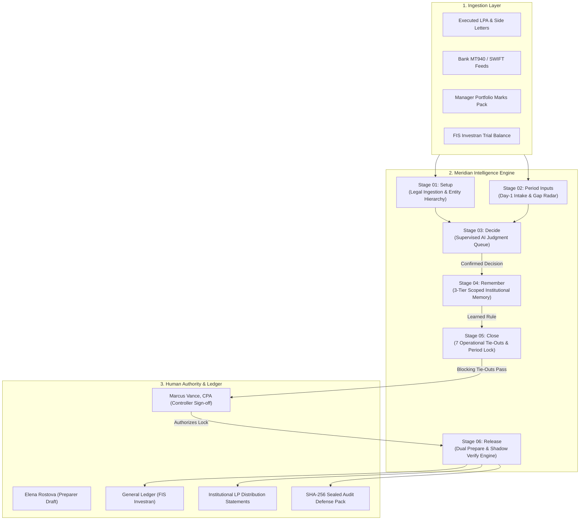

# Meridian — System of Intelligence for Private Markets Operations

[](https://github.com/vikramwish/meridian-fund-ops/actions/workflows/ci.yml)
[](https://www.typescriptlang.org/)
[](https://react.dev/)
[](https://vitest.dev/)
[](https://opensource.org/licenses/MIT)

> **"The record stays the record. Nothing reaches your general ledger before your accountant approves. Rules do the routine. Agents propose with transparent reasoning; fund accountants keep the authority, and decisions become the fund's memory."**

Inspired by modern private markets intelligence architecture (such as Ritamm), **Meridian** is an AI-native system of intelligence built for private equity, venture capital, and multi-entity investment funds. It sits *above* legacy systems of record (e.g. FIS Investran, eFront, Dynamo) and banking portals to automate complex judgment workflows across legal agreements, waterfall distributions, and period tie-outs while enforcing strict human authority.

---

## 🏛️ System Architecture



---

## ⚡ The Six Stages of a Close

1. **Stage 01 — Fund Setup (Legal Terms & Multi-Entity Hierarchy)**:
   - Parses the LPA and side letters into structured rules: 2.0% management fee on committed capital, European whole-fund waterfall (8.0% hurdle, 50% GP catch-up, 20% carry).
   - Maps multi-entity structures: Master Fund LP, Cayman Blocker Feeder, Parallel Co-Invest LP, and GP Carry Vehicle.
   - Dual-authorization: drafted by fund preparer, verified and locked by controller.

2. **Stage 02 — Period Inputs (Day-1 Close Radar)**:
   - Tracks banking feeds, manager valuation packages, general ledger exports, and deal expenses.
   - Detects and flags missing inputs on Day 1 rather than at quarter-end tie-out.

3. **Stage 03 — Decide (Supervised AI Judgment Queue)**:
   - Non-routine accounting transactions queued with step-by-step chain of thought reasoning and confidence scores.
   - Interactive accountant actions: *Approve & Remember*, *Reject*, or *Refine Reasoning*.

4. **Stage 04 — Remember (Fund Institutional Memory Graph)**:
   - 3-tier memory hierarchy:
     - **Fund-Specific**: Learned decisions for this fund only (zero cross-client data leak).
     - **Organization**: Firm-wide house conventions (e.g. 80% transaction fee offset policy).
     - **Global**: Baseline GAAP (ASC 946) & IFRS standards.
   - Confirmed by humans, retirable at any time.

5. **Stage 05 — Close (Operational Tie-Outs & Lock Guardrails)**:
   - 7 Financial modules: Cash, Capital Activity, Portfolio Investments, Management Fees, Net Asset Value (NAV), GP Carried Interest, and Foreign Exchange.
   - Blocking vs. Advisory tie-outs: the period cannot be locked if any blocking variance remains unresolved.

6. **Stage 06 — Release (Prepare Mode & Shadow Verify Engine)**:
   - **Prepare Mode**: Exports balanced double-entry journal entries for FIS Investran and generates personalized Limited Partner distribution notices (CalPERS, ADIA, Ontario Teachers).
   - **Verify Mode**: Shadow recalculation engine that independently recomputes all metrics from raw contracts, proving zero variance against legacy ledgers.
   - Downloadable Cryptographic Audit Pack with SHA-256 provenance seal.

---

## 🔬 Test Coverage & Quality Gates

Meridian includes comprehensive unit and end-to-end test suites:

```bash
npm run test
```

- **Waterfall Engine**: Mathematical verification of European Whole-Fund return of capital, 8.0% hurdle, 50% catch-up, and 80/20 residual splits.
- **Tie-Out Engine**: Variance calculation and blocking period lock enforcement.
- **Memory Engine**: Priority resolution across 3-tier memory scopes.
- **Playwright E2E**: Desktop (1440px) and Mobile (390px) responsive screenshots.

---

## 🛠️ Quickstart

```bash
# Clone the repository
git clone https://github.com/vikramwish/meridian-fund-ops.git
cd meridian-fund-ops

# Install dependencies
npm install

# Start development server
npm run dev

# Run unit tests
npm test

# Build for production
npm run build
```

---

## 📄 License

MIT License. Designed and engineered for graduate SWE / SDET / DevOps portfolio showcasing financial intelligence architecture and rigorous test automation.
